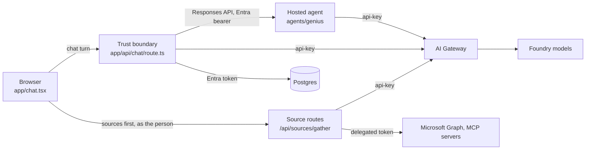

## The three tiers

| Tier | Owns | Never does |
|---|---|---|
| Browser | composer, `useChat`, source lookups before the turn, cards | hold a provider credential |
| Middle tier (Next.js) | sign-in, permissions, credits, Graph and MCP calls as the person, storage, reporting | let a source's text reach the database |
| Hosted agent (C#) | router loop, specialists, consent cards, per-step accounting | hold a Graph token or touch Postgres |

## Blocks: a bundle of rule, tool and model

A **block** pre-configures a chat turn. It is a system-prompt rule, a tool and a model in one key, defined in `lib/blocks.ts`. The free Chat block leaves the choice to the router; a chosen block forces its specialist.

| Block | Control in the composer | Specialist | How it is reached |
|---|---|---|---|
| Chat | default | none (router decides) | always on, cannot be switched off |
| Afbeelding (image) | icon next to `+` | `generate_image` | the icon, or yes on a consent card |
| Onderzoek (research) | none | `research` | yes on a consent card |
| Samenvatten (summarize) | none | `/api/summarize` | automatic for long sources or a file without a question |
| Document | none | `write_document` | the router, revise chips under a document card |

`PILLS` is what the composer renders. A block without a pill still exists for stored conversations and for the paths that send it. Blocks can be switched off per afdeling (department) with the `block:<key>` permission; Chat is `ALWAYS_ON`.

### Consent for paid specialists

`research` and `generate_image` cost real money, so on the free Chat block they do not run. The agent answers `{ confirm, question }` and the UI renders a `ConfirmCard` with the estimate on the yes button. Yes resends the question on the block that forces that specialist, which books the right credit hold. **Picking the block yourself is the consent**, and nothing asks twice.

`Specialists.cs` enforces one card per turn in the tools, and the confirm output states that nothing ran, so the model cannot report a generated image that does not exist.

### Specialists answer with data

Specialists return structured data and the UI renders it as a card in `components/chat/Cards.tsx`:

| Tool | Returns |
|---|---|
| `write_document` | `{ title, markdown }` |
| `research` | `{ report, sources, searches }` |
| `generate_image` | `{ assetId, alt }` |
| `propose_action` | `{ confirm: <kind>, payload }`; never executes |

Failures come back as `{ error, hint }` output, never thrown. Image bytes never enter a message: they go to the `asset` table and the card loads `/api/asset/<id>`, because a tool output is resent to the model on every later turn.

### Write actions need a yes

`propose_action` (calendar event, To Do task, Teams message) only proposes. The card asks the person, then `/api/m365/write` mints the write scope, calls Graph as the person and records a `write_action` row, idempotent on the message part id. A Teams message can only go to a target the card showed.

## Research

Since 2026-10-05 research runs on Claude with Anthropic's own web search tool (`web_search_20250305`, at most three searches). gpt-5 with Bing grounding stays as the non-Claude branch. Changing where search queries go is a privacy decision; record it in the DPIA input.

Sources the person attached can ride along to research: the web call gets the question alone, and a second call without tools merges the material in, so the tool list is the boundary.

## Sources before the turn

Sources are what a person reads from; blocks are what they make. See [Sources and connectors](/developers/sources) for the full flow. In short, the browser calls `lookupSources()` before `/api/chat`, the middle tier searches as the person, and the results travel as `data-source` parts. `inlineSources()` folds them into the model's copy of the last user message; `strip()` removes them before storage.

## Limits and long documents

`lib/limits.ts` holds every cap, each with the arithmetic behind it.

| Constant | Value | Meaning |
|---|---|---|
| `CHUNK_CHARS` | 40 000 | one part of a long summary; a quality and hold number |
| `MAX_SOURCES` | 5 | files per turn; a cost limit |
| `MAX_SOURCE_CHARS` | 400 000 | total sources in one conversation outside Samenvatten |
| `MAX_TURN_CHARS` | 440 000 | one turn; past it `/api/chat` refuses with a sentence |
| `GATEWAY_BODY_CHARS` | 500 000 | the gateway's content-safety ceiling on a serialized body |
| `MAX_REQUEST_CHARS` | derived | the conversation that still fits under the gateway ceiling |
| `MAX_INPUT_CHARS` | 600 000 | Samenvatten's wall-clock bound; it says when it cuts |

The rule is **never cut silently**. A document too long for the turn goes through the reading round in `lib/passages.ts`: a model picks the passages that answer the question (`passagesFor`), and the person is told which parts were read. `fitTurn()` in `lib/sourcecore.ts` keeps short sources whole and only reduces the long ones.

`lib/chunk.ts` splits on `## ` headings, then paragraphs, lines and words, always with a lookahead. `chunk(t, n).join("") === t` must hold exactly; the test asserts it without whitespace normalization.

### Samenvatten keeps its own route

`/api/summarize` is a separate engine: structured output, map/reduce over `CHUNK_CHARS`, and the source kept out of `messages`. For text up to `CHUNK_CHARS` the whole text is seeded into the conversation so a follow-up can quote it. Longer text is not, because `useChat` resends the whole array every turn and the first follow-up would hit the gateway ceiling.

## Chat without skills behaves like claude.ai

When no skill applies, `Prompts.SystemFor` in the agent sends claude.ai's published Opus 5.5 system prompt verbatim (`ClaudeAi.cs`) plus the tools. With attached material it adds only `MaterialGuard`. With skills, the STAS layers apply: role, scope rule, company context, skills. See [Prompts and skills](/developers/prompts-and-skills).

## The shell and apps

Every signed-in page sits in `components/shell/Shell.tsx`: a dock with the apps from `APPS` in `lib/apps.ts`, a per-app panel, the content and a tray. An app exists because it is in the array; the page keeps its own gate. Apps include Home (dashboard), Genius (chat), Meetings, Taken (tasks), Connectoren, Poolcar, Desktop and Beheer (admin).
