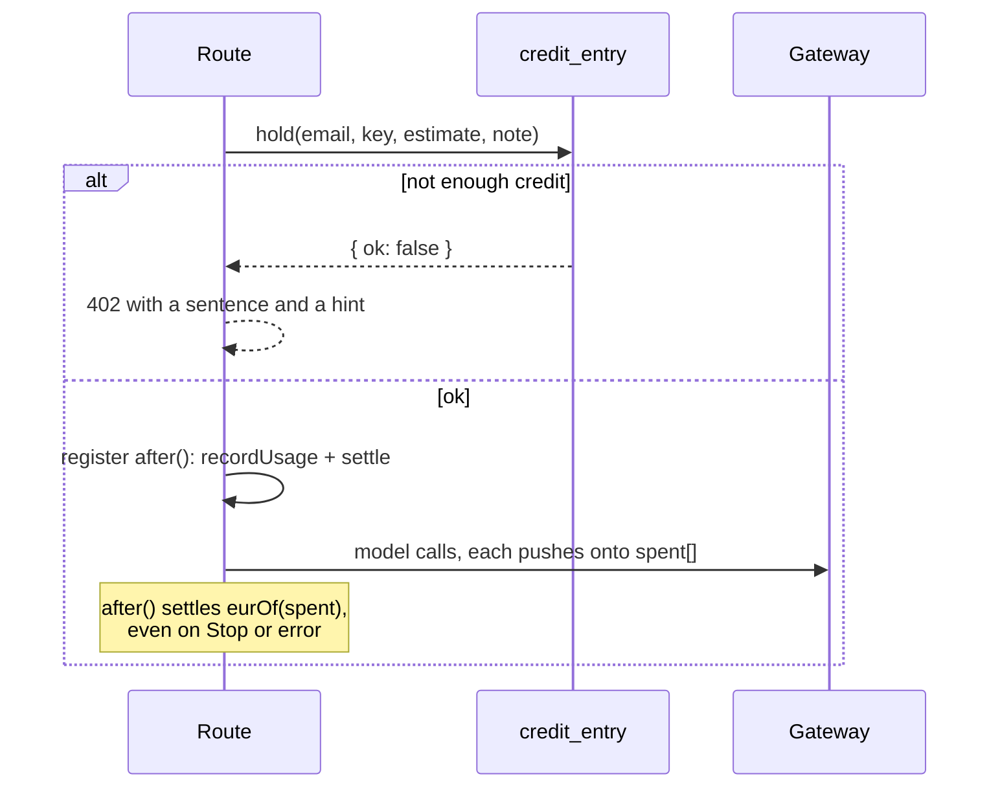

## Two questions that must not blur

| Page | Question | Unit | Source |
|---|---|---|---|
| `/admin/kosten` | What did Azure charge, and who spent it? | euro | Cost Management (`lib/azure-cost.ts`) and `model_usage` (`lib/usage.ts`) |
| `/admin/credits` | Who has how much budget left? | credit | `credit_entry` (`lib/credits.ts`) |

**1 credit = EUR 0.01 of Azure list price** (`CREDIT_EUR` in `lib/costs.ts`). People see credits; admins see euros on the cost page.

## The ledger

`credit_entry` is append-only. There is no balance column: a balance is the sum of a month's rows, so "why is my balance X" is always answerable.

| Kind | Written when |
|---|---|
| `grant` | the first look at a month's balance (lazy, `on conflict do nothing`), or an approved request |
| `hold` | before a paid call, with the estimate |
| `settle` | after the call, with the real cost; releases the rest of the hold |
| `adjust` | an admin correction |

Every row carries a `period` in Brussels months (`periodOf`, tested at the 22:00 UTC boundary). There is no rollover and no expiry job: a new month simply has new rows.

The monthly amount is the person's `monthly_credits`, else the largest of their afdelingen's, else `app_setting.credits_monthly` (default 500).

## Hold, then settle



- `hold()` is book-then-check, so two concurrent requests cannot both pass on the same last credits.
- `canSpend` allows a grace of `monthly × grace%` (default 10 %) below zero, so a run that started can finish.
- Both rows are keyed on the request, so a retried `after()` cannot book twice.
- `runRetention` releases holds older than ten minutes that never settled.
- Pre-turn calls hold too: `LOOKUP_HOLD`, `PICK_HOLD`, `IMAGE_HOLD`, `SHEET_HOLD`, `POWERBI_HOLD`, `CONNECTOR_STRONG_HOLD`, `TRANSCRIBE_HOLD`, `CLEANUP_HOLD`, all in `lib/limits.ts`.

Estimates come from `estimateCredits(block, chars)` in `lib/blocks.ts` and are generous on purpose for the expensive blocks. `lib/credits.test.ts` checks that each hold covers a realistic run at list price. On Claude a chat turn is about 7 credits; holds were recomputed, not measured, when the router moved to Claude.

### Switching credits off

`app_setting.credits_enforced = off` (superadmin switch on `/admin/credits`) makes `hold()` book but never refuse. `/api/credits` reports `enforced: false`, no user surface shows an amount, and the consent card for paid specialists is skipped. Keep the hold and settle calls anyway: the cost book still needs them.

Meetings have their own switch, `meetings_credits`, on `/meetings/beheer`.

## Recording spend

Every model call pushes a `Spent` entry onto the request's `spent` array. `recordUsage(email, route, spent, conversationId)` writes one `model_usage` row per model, and the settle reads the same array.

- In the agent, `RequestScope` and `UsageCaptureChatClient` capture spend in-process and emit a `genius.step` item per router step. The middle tier settles the union of the steps it received, so Stop still bills what ran.
- `count(*)` on `model_usage` counts requests; `sum(calls)` counts model calls.
- Reasoning tokens are inside `outputTokens`. The agent books cache tokens as their input equivalent.

<Callout kind="alert">
  Never `await result.totalUsage` inside `after()` on the chat route. It hangs when the person presses Stop.
</Callout>

## Prices

`lib/costs.ts` holds a price row per model, in EUR, read from the public Azure retail API (`serviceName = Foundry Models`). Claude Opus 5.5 has no Azure retail meter; it is booked at the USD list price converted with Azure's own gpt-5 USD to EUR ratio. Recheck `PRICE_CHECKED_ON` whenever a model changes.

`lib/costs.test.ts` fails when a name in `MODELS` has no price row, and pins the one historical row that bypassed the gateway.

## The Azure bill

`lib/azure-cost.ts` reads Cost Management for the resource group, month to date. It throttles hard (HTTP 429), so results are memoized per process by outcome and the last good figure is kept in `app_setting`. The identity needs Cost Management Reader on the resource group; without `AZURE_SUBSCRIPTION_ID` the page shows only the token-based estimate.

Days are Brussels days in SQL:

```sql
date_trunc($1::text, now() at time zone 'Europe/Brussels') at time zone 'Europe/Brussels'
```
