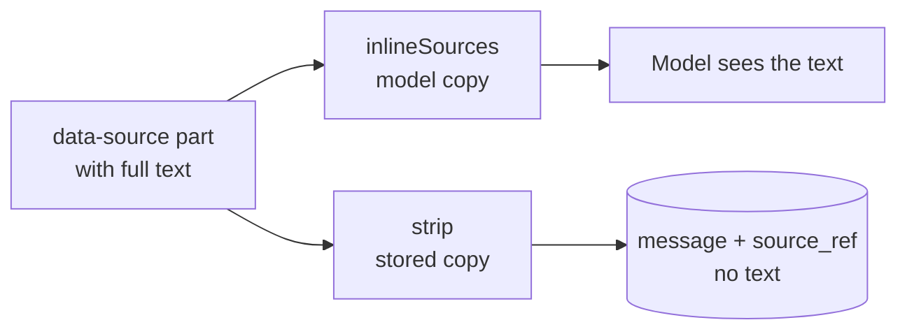

## The database

Postgres 17 Flexible Server with `pgvector` and DiskANN indexes. The whole schema is one idempotent file, `db/schema.sql`, applied with `npm run db:init`. There is no migration framework: additive changes and data migrations are written so that running the file twice is safe.

### Tables by area

| Area | Tables |
|---|---|
| People and access | `app_user`, `department`, `user_department`, `tenant_policy`, `oauth_token`, `admin_log`, `access_log` |
| Chat | `conversation`, `message`, `source_ref`, `asset`, `feedback`, `write_action` |
| Reporting | `message_facet`, `message_embedding`, `message_fact`, `usage_event`, `topic_cluster` |
| Money | `credit_entry`, `credit_request`, `model_usage` |
| Prompts | `skill`, `skill_revision`, `app_setting` |
| Connectors | `mcp_client`, `mcp_connection` |
| Meetings | `meeting_recording`, `meeting_chunk`, `meeting_summary_chunk`, `meeting_share`, `meeting_prep`, `meeting_activity`, `meeting_access_request`, `meeting_mail`, `meeting_attachment` |
| Work | `todo`, `notification`, `department_message` |
| Poolcar | `poolcar_car`, `poolcar_reservation`, `poolcar_event` |

<Callout kind="alert">
  The schema is shared with production. When code reads a new column, run `db:init` **before** the pull request is completed, or the rolled container fails on its first query.
</Callout>

## What is stored, and for how long

| Data | Retention |
|---|---|
| Messages, answers, specialist outputs, per-step traces, uploaded images | 90 days after the last message (`retention_until`) |
| Text of uploaded, pasted or fetched sources | **never**; only a `source_ref` (kind, name, length, HMAC) |
| The remark next to a thumbs-up or down | text nulled at 90 days, row kept 24 months |
| `message_fact`, `usage_event`, `feedback` (content-free) | 24 months |
| Meeting recordings, transcripts, notes, summaries | until the owner deletes them |
| Meeting audio | never on the server; up to 7 days in the browser's IndexedDB outbox |
| `mcp_connection` tokens | until revoked, `removeUser`, or 90 days unused |
| Notifications | 90 days |

Retention runs lazily, without a scheduler: the next list call sweeps expired rows (`runRetention`). Content-free tables have no foreign key, so `runRetention` names each one explicitly.

### strip() and inlineSources()

Both live in `lib/conversations.ts`. A reopened conversation has lost its source texts, so `inlineSources()` drops empty sources rather than sending a heading followed by `undefined`. `lib/conversations.test.ts` pins the round trip.

## Reporting stays aggregate

Reporting follows Anthropic's Clio pattern (`lib/reporting.ts`):

- `annotate()` runs in `after()` and classifies each user turn with the pinned `CLASSIFIER` (`gpt-5-nano/facets-v3`). The embedding has its own `try`, so a missing embedding deployment cannot take the facets down.
- Every breakdown hides groups under k (`reporting_k`, default 5). A masked count is `v: null`, never a hidden number.
- A person in several afdelingen counts in each (`conversation.departments text[]`).
- Clusters run on a button, never on page render.

Admin data screens live under `/admin/data`. Every table there uses `DataTable` (`lib/datatable.ts`).

### Access to individual conversations

Reading a single conversation or exporting the CSV requires a reason, and `access_log` is written first (Belgian CAO 81: collective before individual).

<Callout kind="danger">
  Never use stored conversations or usage data to evaluate a person's performance (EU AI Act Annex III 4(b)). The Mensen (people) view sorts by name and date only and must never become a ranking.
</Callout>

## Subject rights

| Right | Implementation |
|---|---|
| Access (GDPR art. 15) | `GET /api/me/export` |
| Erasure on request | the Mensen page; `removeUser` |
| Leaver | `removeUser` refuses with open credit requests, expires conversations, deletes remarks and revokes tokens and connections; `leaverSweep` removes the address from meeting invitee lists |

A different `entra_oid` on the same address is treated as a new account.

## Processors and the DPIA

Every feature that adds a data category, a processor or a retention rule adds a line to the running DPIA input in `claudedocs/2026-09-07-data-or-en-dpia.md`. A new processor, region or outbound data flow is a decision for the data protection officer before it ships, not after.
