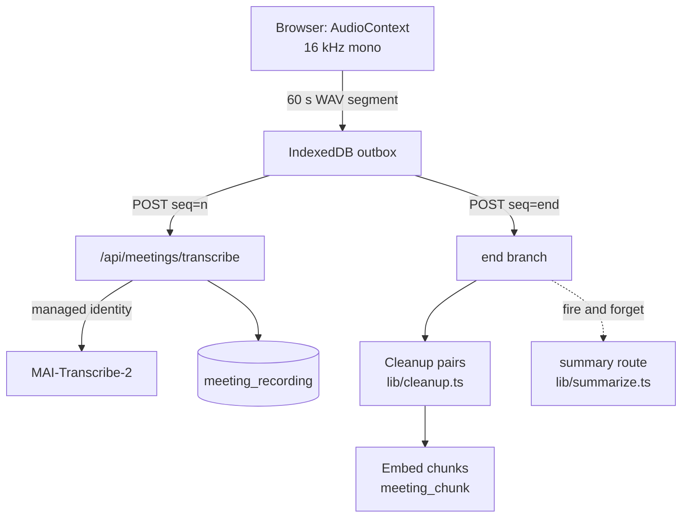

## Overview

Meetings works like Notion AI Meeting Notes. A person clicks **Transcriberen** on any calendar meeting (or starts a new recording), takes notes while the browser records, and gets a cleaned transcript, a structured summary and action items when they press Stop.

| Piece | Code |
|---|---|
| Recorder singleton, segments, pause and recovery | `lib/recorder.ts`, `lib/outbox.ts` |
| Speech call | `lib/speech.ts` |
| Transcript cleanup | `lib/cleanup.ts` |
| Recordings and search | `lib/recordings.ts`, `lib/meetingsearch.ts` |
| Summary engine | `lib/summarize.ts`, `lib/summary.ts`, `lib/templatedef.ts` |
| One page per meeting (the cockpit) | `app/meetings/[id]/page.tsx`, `components/meetings/Cockpit.tsx`, `lib/meetingprep.ts` |

## Recording

- **The unit is a 60-second segment** (`SEGMENT_SECONDS`). Each one is 16-bit PCM WAV, about 1.9 MB.
- **WAV from an `AudioContext`, not `MediaRecorder`**: MAI-Transcribe-2 refuses webm/opus and mp4/aac.
- Every cut goes to the IndexedDB outbox first, with a pointer in `localStorage` and a Web Lock. Finishing is outbox, then checkpoint, then `end`. A crashed tab recovers its audio.
- The recorder is a singleton: navigating does not unmount it.
- Silence and a missing microphone raise a modal (`hearsNothing`, `noMic`), never a stop.
- The desktop app adds system audio (`captureSystem`) in the same tick as the microphone.

## Transcription

MAI-Transcribe-2 is the one model call outside the AI Gateway, by an explicit decision on 2026-09-17. What replaces the gateway's controls: the app's managed identity (no key, role Speech User on one resource), a credit hold before every segment (`TRANSCRIBE_HOLD`), and one `model_usage` row per segment under route `speech`, priced per audio second.

- No `locales`: language is auto-detected across Dutch, French and English.
- `phraseList` carries the invitees, the team and "STAS".
- A 402 interrupts the recording with a sentence. Silently dropping audio is the one unacceptable failure.

## Cleanup and indexing at Stop

The `end` branch of `/api/meetings/transcribe`:

1. **Cleanup** on `MODELS.cleanup`, per `CHUNK_CHARS`. The model returns **replacement pairs**, never rewritten text, and `applyCorrections()` applies them. A pair whose `from` is not in that chunk is discarded, and a pair applies only inside its own chunk. The result is `clean_text`; `coalesce(clean_text, text)` is the one fallback.
2. **Embedding** in chunks of `MEETING_CHUNK_CHARS` (2 000, about 90 seconds of speech) into `meeting_chunk` with a DiskANN index.

Search combines vectors and full-text with reciprocal rank fusion (`lexicalHits`, `fuse`). Only chunks within `MEETING_MAX_DISTANCE` are returned.

## The summary

`stopRecording` fires `POST /api/meetings/recordings/[id]/summary` after the `end` call and does not wait. Separate route, separate hold.

- **Never a second one automatically.** The route answers 409 when a summary exists, and `saveFirstSummary` writes with `and summary is null`. Only *Opnieuw genereren* (`replace: true`) overwrites, and notes survive.
- The engine (`summarizeMeeting`) runs fact and key-fact passes, then prose, then three owner passes that vote two of three on who owns each action item. It reads speaker turns from diarization.
- **Notes win.** The person's live notes are read from the row and take precedence: names in notes beat the transcript, and a contradiction becomes an open question.
- Templates are sections (`lib/templatedef.ts`); see [Prompts and skills](/developers/prompts-and-skills).
- Ticks, edits and notes on the summary card are written back with a debounced `PATCH`.

<Callout kind="tip">
  Measure any change to the summarizer, its prompts or `MODELS.summary` with the `meeting-bench` skill before and after. Single runs are noisy; use blind pairs.
</Callout>

## Sharing and access

| Who | Can |
|---|---|
| Owner | everything: mail, share, delete, reindex, move to another meeting |
| `edit` share | summary, notes, proposals, corrections, regenerate on their own credits, attachments |
| `read` share | read summary, transcript and action items |
| Invitee of the calendar meeting | open the cockpit page (`mayOpenPrep`) |

A share is limited to the owner's tenant. Every write increments `rev`; a 409 means "take over the server's text". Changes by non-owners are listed in `meeting_activity`.

The cockpit `/meetings/<uuid>` is a `meeting_prep` row keyed on Outlook's `iCalUId`, so every invited colleague lands on the same page. Title and invitees are read live from the person's own calendar, never stored from the browser.

## Module switch

Recording and transcription are a **module** (`module:meetings`) that an afdeling can switch off. Off removes only recording and transcription; the calendar, existing recordings and search stay, because they cost nothing. The gate sits on `/api/meetings/transcribe` twice: per segment, and on the `end` branch before cleanup and embedding.
