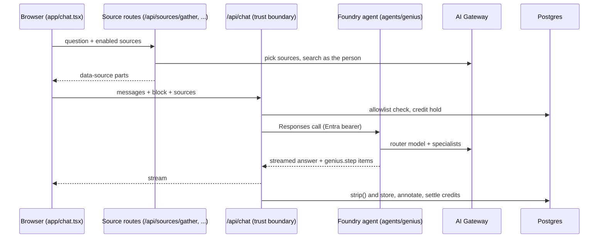

## What you are working on

STAS Genius is the internal AI assistant for STAS. It replaces the public chatbots people were using with one governed tool: a chat in the shape of claude.ai, a meeting recorder and summarizer, tasks, and sources the person switches on (their own mail, calendar, Teams, files, Notion, Power BI).

Three properties drive almost every design decision you will meet:

- **Every model call goes through one Azure AI Gateway.** Credentials, content safety, rate limits and telemetry live there.
- **Everyone has a monthly credit allowance.** Every paid call holds credits before it runs and settles the real cost afterwards.
- **Conversations are stored for reporting**, with a retention clock, a k-anonymity threshold and an access log in front of them.

<Callout kind="info">
  `CLAUDE.md` at the repository root is the source of truth for rules and current facts. Narratives, measurements and design notes live in dated files under `claudedocs/`. These pages are the on-ramp; when they disagree with `CLAUDE.md`, `CLAUDE.md` wins.
</Callout>

## Stack

| Layer | Technology |
|---|---|
| Web app | Next.js 16 App Router, React, shadcn (base-ui), Vercel AI Elements, Streamdown |
| Auth | Auth.js v5 with Microsoft Entra ID, multi-tenant, pinned with `AUTH_TENANTS` |
| AI in the middle tier | AI SDK 7, `@ai-sdk/openai-compatible`, `@ai-sdk/anthropic` |
| Orchestrator | C#/.NET 10 Foundry hosted agent in `agents/genius/` |
| Models | Claude Opus 5.5 (router, research and most jobs), gpt-5-nano (classifier, connector lookups), gpt-5-mini (vision), text-embedding-3-small, gpt-image-1-mini |
| Speech | MAI-Transcribe-2 on the Azure Speech endpoint (the one accepted exception to the gateway rule) |
| Database | Postgres 17 with pgvector and DiskANN, Entra auth only |
| Hosting | Azure Container Apps, deployed by Azure Pipelines on every push to `main` |
| Desktop | Electron shell in `desktop/` that loads the web app |

## How a chat turn flows

1. The browser fetches source material **before** the chat call, as the signed-in person. The agent never holds a Graph token.
2. `app/api/chat/route.ts` is the trust boundary: sign-in, allowlist, credit hold, persistence, settle.
3. The hosted agent runs the router model and calls specialists (`write_document`, `research`, `generate_image`, `propose_action`) as tools. Every one of its model calls goes through the gateway.
4. After the stream, the route strips source text, stores the conversation, classifies the turn for reporting and settles credits from the real spend.

## Where things live

| Concern | Start here |
|---|---|
| Sign-in and tenants | `auth.ts`, `lib/tenants.ts`, `lib/access.ts` |
| Rights and admin areas | `lib/permissions.ts`, `lib/rbac.ts` |
| Models and the gateway | `lib/model.ts` (`MODELS`) |
| Every system prompt | `lib/prompt.ts`, twin rules in `agents/genius/.../Prompts.cs` |
| Blocks and credit estimates | `lib/blocks.ts` |
| Credits and cost | `lib/credits.ts`, `lib/costs.ts`, `lib/usage.ts` |
| Conversations and privacy | `lib/conversations.ts`, `lib/reporting.ts` |
| Sources | `lib/lookup.ts`, `lib/sources.ts`, `lib/m365.ts`, `lib/mcp.ts`, `lib/powerbi.ts` |
| Meetings | `lib/recorder.ts`, `lib/speech.ts`, `lib/summarize.ts`, `components/meetings/` |
| Limits and chunking | `lib/limits.ts`, `lib/chunk.ts` |
| Schema | `db/schema.sql` |

The full file-by-file table is `claudedocs/2026-09-24-layout.md`. Add a row there when you add a file.

## Suggested reading order

1. [Local setup](/developers/local-setup), then [Hard rules](/developers/hard-rules) and [Workflow](/developers/workflow) before your first change.
2. [Architecture](/developers/architecture), [Foundry agent](/developers/agent) and [Models and gateway](/developers/models) to understand a chat turn end to end.
3. The page for the area you touch: [Sources](/developers/sources), [Meetings](/developers/meetings), [Prompts and skills](/developers/prompts-and-skills), [Auth and permissions](/developers/auth-and-permissions), [Data and privacy](/developers/data-and-privacy), [Credits and costs](/developers/credits-and-costs), [Frontend conventions](/developers/frontend).
4. Keep [Recipes](/developers/recipes), [Gotchas](/developers/gotchas), [Testing](/developers/testing) and the [Glossary](/developers/glossary) at hand.

<Callout kind="tip">
  Working with an AI coding agent? Point it at `CLAUDE.md` and `AGENTS.md` in the repository root, and at the project skills in `.claude/skills/` (isolate, build, prove, ship, meeting-bench). They carry the same rules as these pages, in the form an agent loads.
</Callout>

## Next steps

<Columns cols="2">
  <Card title="Local setup" href="/developers/local-setup" icon="terminal" horizontal="false">
    Run the app on your machine against the shared Azure resources.
  </Card>

  <Card title="Hard rules" href="/developers/hard-rules" icon="shield" horizontal="false">
    The rules a change must never break, and why each one exists.
  </Card>

  <Card title="Architecture" href="/developers/architecture" icon="layers" horizontal="false">
    Blocks, specialists, sources, credits and storage in depth.
  </Card>

  <Card title="Workflow" href="/developers/workflow" icon="git-branch" horizontal="false">
    Isolate, build, prove, ship: how a change reaches production.
  </Card>
</Columns>
