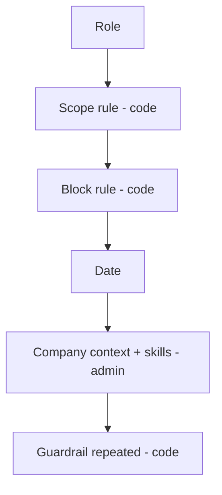

## One place per tier

| Tier | File | Builds |
|---|---|---|
| Middle tier | `lib/prompt.ts` | every prompt the web app sends: summaries, source pick, query extraction, meeting passes, cleanup, reporting facets |
| Agent | `agents/genius/src/genius/Orchestrator/Prompts.cs` | the router's system prompt, block rules, source and format rules, consent notes |

Some rules exist in both, as twins: `MEETING_RULE` and `MeetingRule`, `SOURCE_RULE` and `SourceRule`, `FORMAT_RULE` and `FormatRule`, the scope rules. **Change both in the same change.** Drifting copies make the assistant behave differently depending on which path a question took.

Prompts are written in English; answers come back in the person's language through `LANGUAGE_INSTRUCTION`. Only the company context is in whatever language the admin typed.

## The layers

With skills active, the chat prompt is built in this order:

1. **Role**: what the assistant is for.
2. **Scope rule**: fixed in code (`CHAT_SCOPE_RULE` / `ScopeRule`).
3. **Block rule**: what the chosen block asks for (`BLOCK_RULE`).
4. **Date**.
5. **Company context and skills**: one JSON array of `{ kind, name, body }` in a single `developer` item.
6. **The guardrail again**, after the skills, because nothing can follow it.

**Which layer is editable is the design.** An admin can set tone, wording, format and background. An admin cannot widen what the assistant does: if the guardrail were an editable textarea, clearing it would switch it off and nothing would say so.

### Without skills: claude.ai's prompt

Since 2026-10-05, when no skill applies, the agent sends claude.ai's published Opus 5.5 system prompt verbatim (`ClaudeAi.cs`) plus the tools, with only `MaterialGuard` added when material is attached. No role, scope rule or company context. Refresh `ClaudeAi.cs` when Anthropic publishes a new version.

### The scope rule

The chat answers general and domain questions concretely. It never invents facts about the person's own situation (a cause, amount, name, date or commitment); it leaves those as `[...]`. It never claims to have searched, written or generated something without the tool result to show for it. The summarizer keeps the stricter `SCOPE_RULE`.

There is no second classifier call to police scope: it would double latency and cost and add a second place where "what is allowed" is defined.

## Skills

A **skill** is a named instruction bundle an admin edits at `/admin/skills` without a deploy. It is a row in the `skill` table.

| Kind | Applies | Example |
|---|---|---|
| `context` | every turn, exactly one row, framed as background | who STAS is, jargon |
| `always` | every turn | tone of voice, house style |
| `selectable` | at most one per turn, chosen with a chip | a report format, a meeting summary template |

- `skill.block` limits a skill to one block (`''` = every block). `skill.departments` limits it to afdelingen (empty = everyone). `appliesTo()` is the one predicate behind both the payload and the chips.
- `MAX_SKILL_CHARS` (6 000) and `MAX_SKILLS_CHARS` (12 000) bound cost per turn.
- Every turn records the skill names and a 12-character hash of the payload in `message.trace.skills`.
- `research`, `generate_image`, the facet classifier and the map step of a long summary ignore skills.

<Callout kind="alert">
  Saving a skill is gated against the EU AI Act: `blockedPhrase` refuses a judging verb near a word for a person (Annex III 4(b), Article 5). Do not loosen it to make a test pass.
</Callout>

<Callout kind="info">
  Deploy the agent before the web container when the skill payload shape changes. New JSON reaching an old agent is pasted in as background, with no error.
</Callout>

## Meeting summary templates

Meeting templates are `selectable` skills on the Samenvatten block, defined as sections since 2026-10-02 (`lib/templatedef.ts`): custom sections (title, question, list or table) plus the fixed blocks a template may place, rename or hide. A template's own system message wins on structure and length, never on accuracy; the fact, key-fact and owner passes never see it. The standard template is pinned byte for byte by `lib/summarize-prompts.test.ts`.

## Changing a prompt safely

<Steps>
  <Step title="Find both copies" icon="search" title-type="h3">
    Search `lib/prompt.ts` and `Prompts.cs` for the rule. If it has a twin, change both.
  </Step>

  <Step title="Measure before and after" icon="gauge" title-type="h3">
    Use the bench that covers the path:

    | Path | Bench |
    |---|---|
    | Chat answers | `scripts/chat-bench/` |
    | Source pick | `scripts/pick-bench.mts` |
    | Meeting summary | skill `meeting-bench` (`scripts/meeting-bench/`) |
    | Questions about a meeting | `scripts/meeting-bench/qa/` with blind pairs |
    | Meeting search | skill `meeting-find-bench` |
    | Summary templates | `scripts/template-regression.mts` |
  </Step>

  <Step title="Pin what matters" icon="pin" title-type="h3">
    `lib/prompt.test.ts` and `lib/summarize-prompts.test.ts` pin load-bearing sentences. Update the pin deliberately, never to silence a failure.
  </Step>

  <Step title="Deploy the agent if Prompts.cs changed" icon="rocket" title-type="h3">
    `azd deploy --no-prompt` from `agents/genius`, before the web container.
  </Step>
</Steps>
