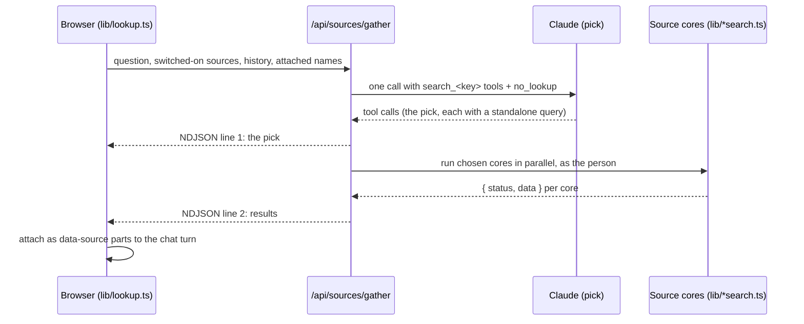

## The principle: the app searches, the agent reads

A **source** is something a person reads from. Each one is a tile on `/connectoren`, off by default and switched on per person. The search always runs in the middle tier, **as the signed-in person**, before `/api/chat`. The agent only ever sees text; it never holds a Graph or connector token.

| Source | Key | Route | Token |
|---|---|---|---|
| Mail, Agenda | `mail`, `calendar` | `/api/m365/search` | Graph, delegated |
| Teams | `teams` | `/api/graph/search` | Graph, `Chat.Read` minted per request |
| Files (OneDrive, SharePoint) | `files` | `/api/files/search` | Graph, `Files.Read.All Sites.Read.All` |
| OneNote | `onenote` | `/api/onenote/search` | Graph, `Notes.Read.All` |
| Meetings | `meetings` | `/api/meetings/search` | none: the person's own recordings |
| Power BI | `powerbi` | `/api/powerbi/search` | Fabric MCP server, own consent round |
| Notion, Atlassian | connector key | `/api/mcp/search` | OAuth 2.1 via `@ai-sdk/mcp` |

## How one lookup runs



Rules that are easy to break:

- **No tool call means all sources** (`sourcesFromCalls`). Only `no_lookup` empties the list. An empty pick used to silently cost a question every source.
- **A follow-up stays with its source.** The pick reads the conversation and the `keys` of the last turn that found something.
- **Attachments make the pick strict.** With files attached, an empty pick means no source.
- **One slow source cannot hold the others hostage.** `runCore` gives each core a deadline; a timed-out core answers as failed and the rest keep their results.
- **If the gather fails, the browser runs the old per-source routes**, so a broken gather degrades to the previous behaviour instead of a worse one.
- Each core holds and settles its own credits (`LOOKUP_HOLD`); the gather holds `PICK_HOLD` for the model call.

The cores live in `lib/*search.ts` and are shared by the gather and by the individual routes, so both paths run the same code. `lib/sourcecore.ts` holds the shared shape.

## Graph sources

Graph sources are rows in `GRAPH_SOURCES` in `lib/graphsources.ts`:

```ts title="lib/graphsources.ts"
{
  key: "calendar",
  label: "gsource.calendar",     // i18n key
  scope: "Calendars.Read",       // null = nothing to ask
  consent: "renew",              // "renew" | "own" | "none"
  route: "/api/m365/search",     // sources with the same route share one request
  kind: "m365",                  // "m365" | "mcp" | "meeting"
}
```

- Extra scopes are minted per request with `tokenForScope()` from the stored refresh token. They are **never** added to `DEFAULT_SCOPES`: a scope there that a tenant has not consented to blocks everybody's sign-in.
- The tile switches on based on the outcome (a token with the scope), never on Entra's error text.
- `app_user.graph_sources` is checked before any model or Graph call.
- Shared mailboxes are read as the person; Exchange is the gate. A refusing mailbox is named in its own section, never just counted.

## MCP connectors

Notion and Atlassian connect with the person's own account at `/connectoren`.

- `@ai-sdk/mcp` handles the OAuth 2.1 flow (`lib/mcp.ts`). Tokens live in `mcp_connection`, sealed under a second key, and die on `removeUser` or after 90 days unused.
- The server's tool list is filtered to an **allowlist of measured read tools** (`readTools`). A write tool a server adds later never reaches the model. Notion offers 44 tools; two are allowed.
- `gather` runs on gpt-5-nano with at most four steps and is told to fetch, never answer. Connectors that need a written query (JQL) use `connectorStrong` on Claude.
- The client registration origin is `AUTH_URL`, never `req.url`, which reads `https://0.0.0.0:3000` inside Container Apps.

<Callout kind="danger">
  Never run `gather()` from a script against another person's `mcp_connection` row: a token refresh from the wrong origin can invalidate their connection. Use your own row, from the right origin.
</Callout>

## Links, files and images

| Input | Handling |
|---|---|
| A URL in the question | `/api/fetch` reads the page and its same-origin stylesheets. SSRF guarded: http/https only, every DNS answer and redirect hop checked, byte and time caps. |
| A SharePoint link | goes to the files route, not `/api/fetch` |
| PDF, Word, PowerPoint, text | parsed in `lib/extract.ts`; no model call |
| Excel | parsed per sheet; a workbook too large for the turn is filtered by row numbers (`lib/sheetfilter.ts`), never cut |
| Image | described once by `gpt-5-mini` (`describeImage`), then travels as text; scaled to `IMAGE_MAX_EDGE` 1 280 px |

## Add a new source

<Steps>
  <Step title="Register the scope" icon="key-round" title-type="h3">
    Add the scope to `REGISTERED_SCOPES`, then to the Entra app registration with `az ad app permission add`. Each customer tenant needs an admin consent round, because a tenant admin's consent replaces the grant list.
  </Step>

  <Step title="Write the core" icon="code" title-type="h3">
    Add `lib/<name>search.ts` returning `{ status, data }` with the hits as text, one `## ` heading per hit. Hold `LOOKUP_HOLD` before any model call and settle in `after()`. Zero hits is a one-line source that says what was searched, not `null`.
  </Step>

  <Step title="Wire it up" icon="cable" title-type="h3">
    Add the row to `GRAPH_SOURCES`, a route that calls the core through `capped()`, the core to `CORES` in `/api/sources/gather/route.ts`, and a hint to `SOURCE_HINTS` in `lib/sources.ts` so the pick knows what the source holds.
  </Step>

  <Step title="Strings, privacy and tests" icon="check-circle" title-type="h3">
    Add the label in all three languages. Add a DPIA line to `claudedocs/2026-09-07-data-or-en-dpia.md`. Extend `lib/sources.test.ts` or the core's test, and run the pick bench (`scripts/pick-bench.mts`) to check the pick still chooses correctly.
  </Step>
</Steps>
