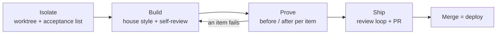

## The software factory

Every change runs through four steps. Each step is a project skill in `.claude/skills/<step>/SKILL.md`, and `AGENTS.md` carries the same table for other AI coding tools.



<Callout kind="alert">
  The root checkout is shared between parallel sessions and never changes branch. Do not run `git stash`, `git checkout` or `git reset` there. Work happens in a worktree.
</Callout>

<Steps>
  <Step title="Isolate" icon="git-branch" title-type="h3">
    Start from the latest `origin/main`, not from the root checkout, which is often behind.

    ```bash
    git fetch origin
    git worktree list   # someone may already be on it
    ```

    Create a worktree on branch `worktree-<name>`, link `.env.local`, install dependencies, and confirm a green baseline with `npm test`. Then write the **acceptance list** before the first edit: each item is a behaviour you will prove later.
  </Step>

  <Step title="Build" icon="hammer" title-type="h3">
    Write code that reads like the code around it: the same naming, comment density and idioms. Reuse an existing helper before writing a new one. Finish with a self-review of your own diff.

    Rules worth repeating here:

    - A new user-facing string goes into `lib/i18n.ts` in all three languages.
    - A new file gets a row in `claudedocs/2026-09-24-layout.md`.
    - A new feature gets a dated design note in `claudedocs/` and a short summary with a pointer in `CLAUDE.md`. Keep `CLAUDE.md` under 110 000 characters.
  </Step>

  <Step title="Prove" icon="check-circle" title-type="h3">
    For each acceptance item, record the state before and after: a screenshot under `claudedocs/proof/`, a number, or an output pair. Check the after state yourself. A failed item sends you back to Build.

    Passing tests are not proof that a feature works. Show the feature working in the real app.
  </Step>

  <Step title="Ship" icon="rocket" title-type="h3">
    1. Merge `origin/main` into your branch and resolve conflicts.
    2. Run `npm test` and `npm run lint` on the merged result. If `db/schema.sql` changed, run `npm run db:init` now.
    3. Scan the diff for secrets before it leaves your machine:

       ```bash
       git diff origin/main > "$TMPDIR/diff.patch"
       gitleaks dir --no-banner --redact --exit-code 1 "$TMPDIR/diff.patch"
       ```

    4. Run `cr review --agent --base origin/main` and fix findings until there are zero Critical and zero Warning.
    5. Open the pull request on Azure DevOps with the proof in the description:

       ```bash
       az repos pr create --source-branch worktree-<name> --target-branch main
       ```

    <Callout kind="info">
      `az repos pr create` refuses descriptions over 4 000 characters. Link the proof folder once rather than every screenshot.
    </Callout>
  </Step>
</Steps>

## Source control and deploys

The repository lives on Azure DevOps. Git authenticates with your `az login` through a credential helper, so there is no personal access token. Use `az repos pr`, not `gh`.

Completing a pull request pushes to `main`, and **a push to `main` is the deploy**. The Azure pipeline (`azure-pipelines.yml`) runs lint, tests, `az acr build` and `az containerapp update`. The trigger lags about four minutes, a run takes about ten, and there is one build slot.

### Deploy order

When a change spans several parts, deploy them in this order:

| Order | What | How |
|---|---|---|
| 1 | Database schema | `npm run db:init` before the merge |
| 2 | Foundry agent | `azd deploy --no-prompt` from `agents/genius` |
| 3 | Web container | complete the pull request |

The agent and the schema are never deployed by the pipeline. A new payload reaching an old agent, or new code reading a missing column, fails without an obvious error.

## Before you call it done

- `npm run lint`, `npx tsc --noEmit` and `npm test` pass.
- A diff that touches auth, credentials, untrusted input, SQL, shell, file paths, network fetchers or dependencies has had a security review.
- Every acceptance item has its before and after proof.
- `CLAUDE.md` and the dated note in `claudedocs/` describe the change.
