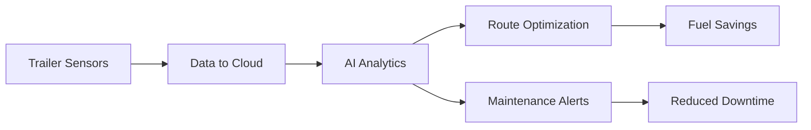

## Overview

Sea-it equips your trailer with advanced technologies that prioritize safety, boost efficiency, and adapt to your operations. You gain real-time insights into trailer performance, preventing downtime and optimizing routes. Key areas include innovative trailer technologies, robust safety systems, efficiency tools, and proven industry applications.

<Columns cols={3}>
  <Card title="Trailer Technologies" icon="settings" href="#trailer-technologies">
    Monitor and control core trailer functions remotely.
  </Card>
  <Card title="Safety Systems" icon="shield" href="#safety-systems">
    Detect risks early with automated alerts.
  </Card>
  <Card title="Efficiency Improvements" icon="zap" href="#efficiency-improvements">
    Reduce fuel use and maintenance through smart analytics.
  </Card>
</Columns>

## Trailer Technologies

Sea-it integrates sensors and IoT devices into your trailer for comprehensive monitoring. You track tire pressure, axle load, and brake status in real time via the dashboard at `https://dashboard.example.com`.

<Steps>
  <Step title="Connect Trailer" icon="truck">
    Pair your Sea-it device using the mobile app or web portal.
  </Step>
  <Step title="Configure Sensors" icon="settings">
    Set thresholds for tire pressure (`<100psi`) and load limits (`>20 tons`).
  </Step>
  <Step title="View Data" icon="bar-chart">
    Access live feeds and historical logs.
  </Step>
</Steps>

<Callout kind="tip">
  Start with default sensor configurations to get up and running quickly.
</Callout>

## Safety Systems

Safety features in Sea-it use AI-driven detection to alert you of potential hazards like overheating brakes or unstable loads.

<Tabs>
  <Tab title="Brake Monitoring" icon="alert-triangle">
    Receive instant notifications if brake temperature exceeds `>150°C`.

    ```javascript
    // Example API check for brake status
    const response = await fetch('https://api.example.com/v1/trailers/123/safety/brakes');
    const data = await response.json();
    if (data.temperature > 150) {
      alert('Brake overheating detected!');
    }
    ```
  </Tab>
  <Tab title="Load Stability" icon="balance">
    Analyze weight distribution to prevent tipping.

    ```javascript
    // Query load sensors
    const stability = await fetch('https://api.example.com/v1/trailers/123/load');
    const { balanceScore } = await stability.json();
    console.log(`Stability: ${balanceScore}/100`);
    ```
  </Tab>
</Tabs>

## Efficiency Improvements

Optimize operations with Sea-it's analytics that predict maintenance and suggest efficient routes. You save up to 15% on fuel by avoiding overloads.



<CodeGroup tabs="JavaScript,Python">
  ```javascript
  // Fetch efficiency report
  const report = await fetch('https://api.example.com/v1/trailers/123/efficiency');
  const { fuelSavings, predictions } = await report.json();
  console.log(fuelSavings);
  ```
  ```python
  # Fetch efficiency report
  import requests
  response = requests.get('https://api.example.com/v1/trailers/123/efficiency')
  data = response.json()
  print(data['fuelSavings'])
  ```
</CodeGroup>

## Industry Use Cases

See how Sea-it transforms operations across sectors.

<Board title="Sea-it in Action">
  <BoardColumn title="Logistics" color="1" icon="truck">
    <BoardCard title="Fleet Tracking" description="Real-time location for 100+ trailers" icon="map-pin" dueDate="Ongoing" />
    <BoardCard title="Dynamic Routing" description="Avoid traffic delays automatically" />
  </BoardColumn>
  <BoardColumn title="Construction" color="2" icon="hard-hat">
    <BoardCard title="Load Verification" description="Ensure safe transport of heavy equipment" icon="package" author="Site Manager" />
  </BoardColumn>
  <BoardColumn title="Agriculture" color="0" icon="sprout">
    <BoardCard title="Harvest Hauls" description="Monitor crop loads for freshness" createdAt="2024-10-01" />
  </BoardColumn>
</Board>

<Expandable title="Advanced Customization" default-open="false">
  Tailor Sea-it alerts and dashboards to your fleet size using the config API at `https://api.example.com/v1/config`.
</Expandable>

<Columns cols={2}>
  <Card title="Quickstart" icon="book-open" href="/quickstart">
    Set up your first trailer.
  </Card>
  <Card title="API Reference" icon="code" href="/authentication">
    Integrate programmatically.
  </Card>
</Columns>